### Microsoft Azure AD SAML Integration

In this scenerio, we will achieve below:

- SAML Service Provider: Cognito
- SAML Identity Provider: Microsoft AD 

Provider Name: 'AzureADSaml'

Redirect or Reply: https://<your-cognito-domain>.auth.us-east-1.amazoncognito.com/saml2/idpresponse

SP entity ID: urn:amazon:cognito:sp:<your-user-pool-id>

------------------------------------------------------------------------------------------

### Azure AD Server Providers Notes: Must provide emailAddress

#### User Attribute Mapping

To inter-operate with our app, Azure AD provider MUSt provide a unique email address per user mapped as below. Or if an alternative value of email is assigned under user object that can be provided. Key poitn is email field sent to our server as empty will fail as seen below. 

        emailaddress    user.userprincipalname

Hence, ABOVE maping is MANDATORY and emailaddress MUST not be empty. Mapping can be change with assumption that emailaddress is not empty else you will receive error as below if email is empty

        Value at 'username' failed to satisfy constraint: Member must have length greater than or equal to 1

#### EXT External Email Handling: such as gmail

NOTE: For sign in with gmail, facebook, apple amazon, we have separate OAuth2 workflow which works directly in AWS Cognito and will not need Microsoft AD. Therefore below issue is FYI Only.

If external email is used for logging in (such as gmail), cognite will receive below loooking email

        someuser_gmail.com#EXT#@<your-tenant>.onmicrosoft.com

This email will not translate to username in pre-signup lambda function. It will be logged in as a user but we will see two users registered n Lambda. 

Reason this is happening is, becase I can use my own gmail account to login, which is Azure AD users. I am not part of microsot AD and ONLY tets users are, hence I will delete myself as SAML user and this will work as expected.

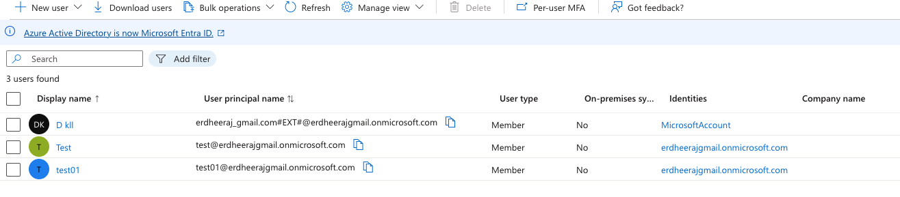

Error received when deliting myself as I am owner of the directory. In real world, owner is from same domain as users and hence this issues shall not exsist. Below issue is purely because of the way I have setup my dev lab.

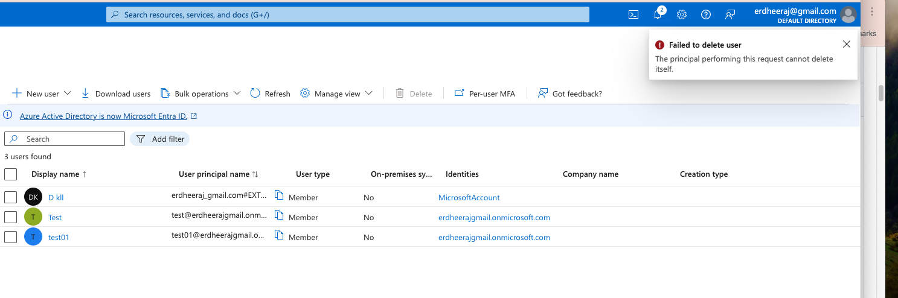

In Future, adding external users in SAML need to be tackled as a separate use case and will need updates to

1. Pre-sugnup lambda
2. Potentially other lambdas.

This is left for future work.

------------------------------------------------------------------------------------------

### IMPORTANT Azure AD CONFIGURATION NOTES

We have two major issues in setting Azure AD.

#### ISSUE 1 is client need admin authorization to sign in as below.

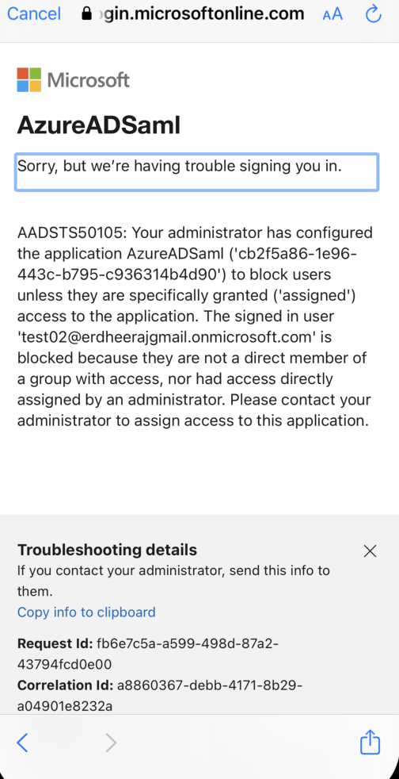

FIX: To resolve this, you MUST set below i.e. Assignment Required to No.

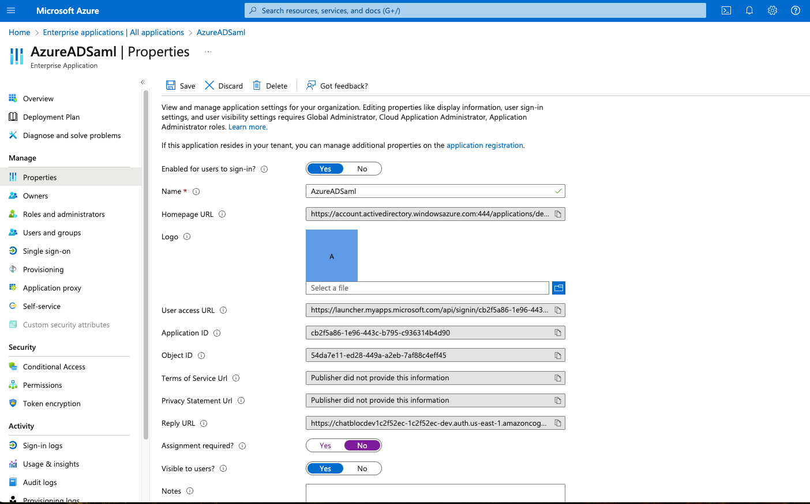

#### ISSUE 2:  "message": "2 validation errors detected: Value at 'username' failed to satisfy constraint: Member must satisfy regular expression pattern: [\\p{L}\\p{M}\\p{S}\\p{N}\\p{P}] ; Value at 'username' failed to satisfy constraint: Member must have length greater than or equal to 1"
                flutter: 

REASON: Above issue was becasue email field was empty in pre-signup lambda when received because of mapping attribute as below. 

NOTE, I am not sure how to mal email to mail.

        email -> user.mail.

FIX: To fix this, I need to alter user attribute mapping for email as below. We mapped user email to UPN.
And after that we were able to correctly receive user email. 

        email -> user.userprincipalname

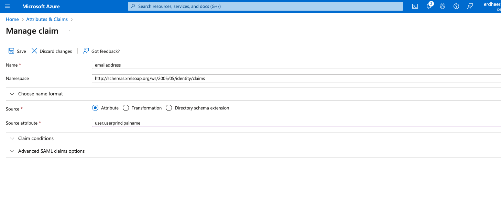

Results. Also, I am are unclear on how to access Unique User Identifier i.e. what is the keyword is it "sub". However, email is unique enough and hence there shall be no issues in mapping UPN. In future we will optimize with server provider if they provide email.

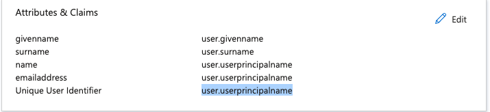

#### ISSUE 3: Web Redirect Home Page showing Microsoft.

Resolution: We need to fina a place in Azure AD, where the logout URL is of type "redirect" and not "Push". Currently logout url consifuration is set to PUSH, Once we know how to set it ti redirect and point either to http:localhost:3000/ for test locally or actually home page of you client app if production, this will work (we have validated this apprach when working with keycloak OpenID)

To fix, this set a redirect logout as below. This redirect may need to be changed in production to a real domain.

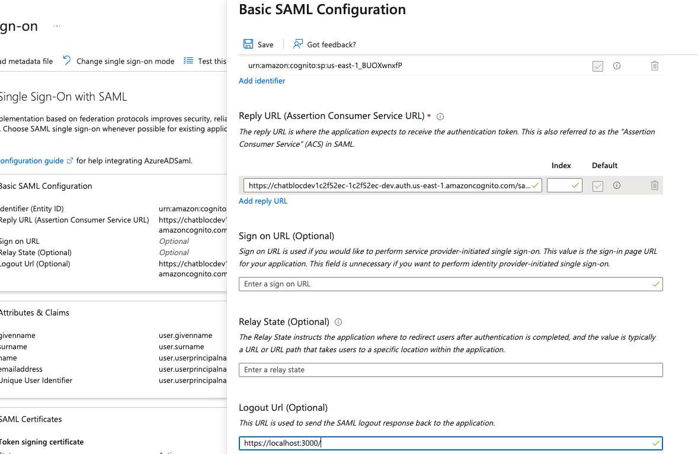

We reverted the change back to leave user at microsoft page.

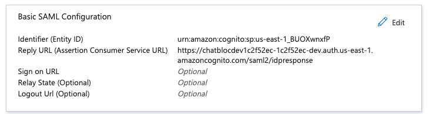

#### CONCLUSION: TROUBLESHOOTING

In future, you MUST check, if email attribte value is empty when received my lambda and assign it to unique user email.

------------------------------------------------------------------------------------------
### What is received by Lambda

        Input string Received is azureadsaml_test@<your-tenant>.onmicrosoft.com
        Input ID Received is test@<your-tenant>.onmicrosoft.com
        Input Provider name Received is AzureADSaml

---------------------------------------------------------------------------------------

### Setup Microsoft AD

1. Create a AD

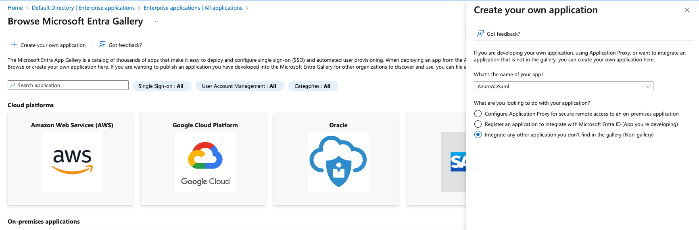

2. Go to SAML

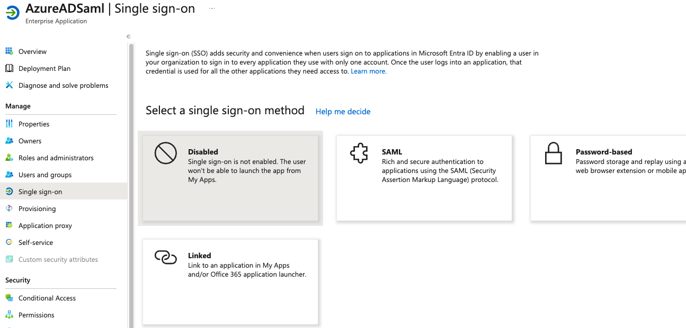

3. Fill in reply URL and ID

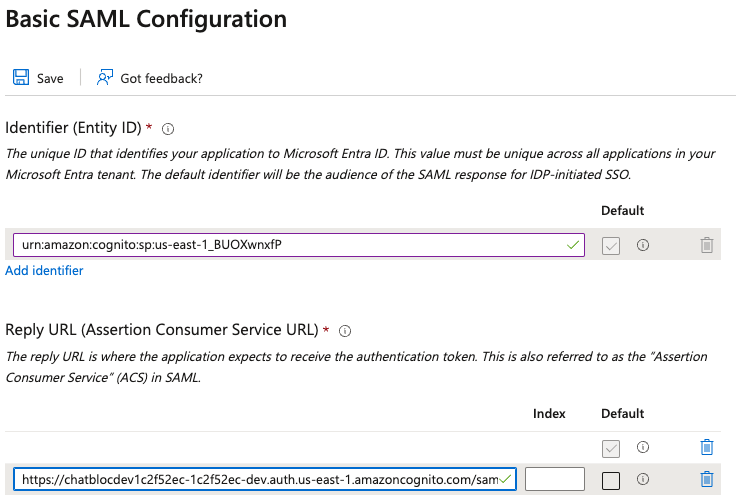

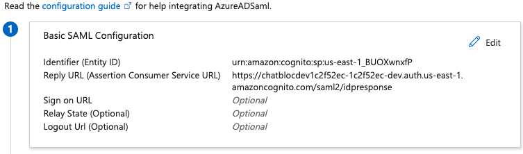

4. No change to attributes & claims

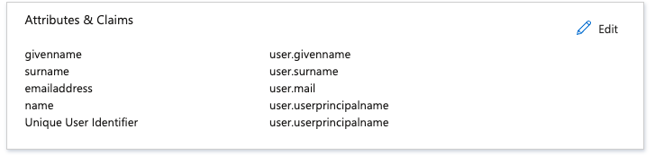

5. Get metadat URL to pass to AWS

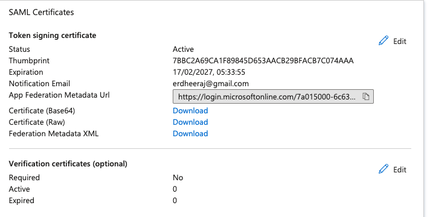

6. Metadat URL example

    https://login.microsoftonline.com/<tenant-id>/federationmetadata/2007-06/federationmetadata.xml?appid=<app-id>
    

7. Now Setup AWS to add new IDP as below:

Key Items to Add: 

        Friendly Name: AzureADSaml
        Metadata Link URL: as above.
        Map Attributes Between Cognito and Azure AD. 
        Add Sign Out Flow checked so we sign out from both cognit and Azure.

        Attrbites (AzureADSaml | SAML-based Sign-on)
        http://schemas.xmlsoap.org/ws/2005/05/identity/claims/emailaddress
        http://schemas.xmlsoap.org/ws/2005/05/identity/claims/givenname
        http://schemas.xmlsoap.org/ws/2005/05/identity/claims/name
        http://schemas.xmlsoap.org/ws/2005/05/identity/claims/surname 

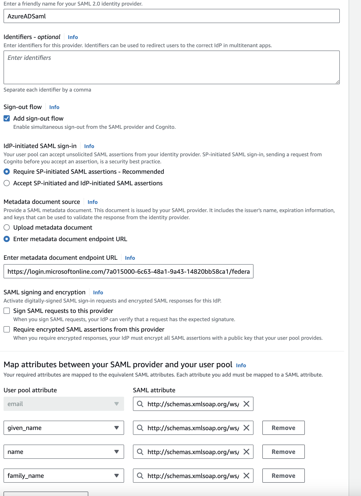

8. Idp Added as below

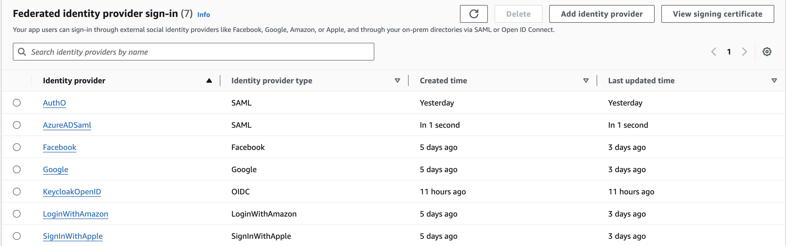

9. Now go to App integration and add Azure AD to both web and mobile clients as exemple below.

        <app_client_web>	
        <app_client>
    
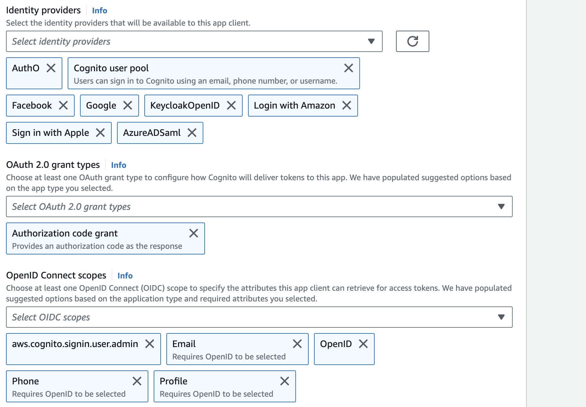

10. Now create couple of users in Azure AD. Search users

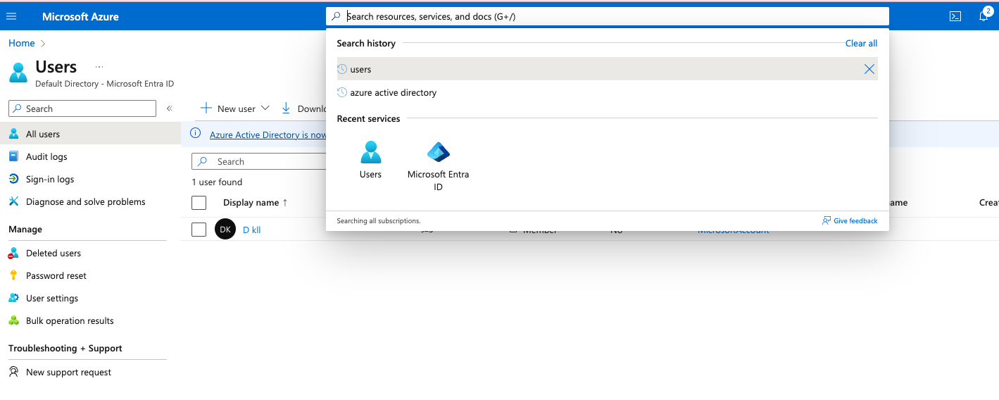

11. Then create a test user

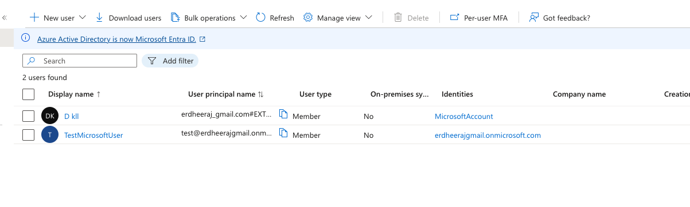

12. Now setup your client app as below

        // Provider name MUST match as setup in AWS
        // Lambda function MUST be adjusted to allow this provider name 
        // (pre-sign up and post auth specifically)
        const samlAzurdeADProviderName = 'AzureADSaml';    
        if (socialSignInOption == SocialSignInOption.azuread) {
        return const AuthProvider.saml(samlAzurdeADProviderName);
        }

12. Set Assign Required to No as per image below for your group, otherwise you will have issues as shown below on 'assigned' to group.

13. Login and test with various clients. 

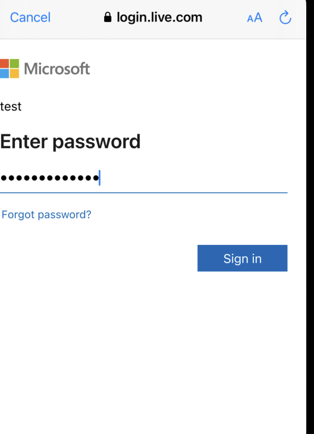

14. After fixing issues as listed in Appendix, Azure AD worked as expected. Verified on iOS, Adnroid, MACoS, & Chrome Web.

Test Users Created 

        Microsoft Azure AD Test Email: 

        Email: <redacted-test-email-1>@<your-tenant>.onmicrosoft.com
        Password: <REDACTED_PASSWORD>

        <redacted-test-email-2>@<your-tenant>.onmicrosoft.com
        Password: <REDACTED_PASSWORD>

        Input string Received is azureadsaml_test@<your-tenant>.onmicrosoft.com
        Input ID Received is test@<your-tenant>.onmicrosoft.com
        Input Provider name Received is AzureADSaml

--------------------------------------------------------------------------------------------

### KEY ISSUES RESOLVED: Azure AD

ISSUE 1: Invalid SAML response received: PreSignUp invocation failed due to error AccessDeniedException.

Resolution: Pre-signup lambda was uploade to server but not assigned to User Pools. Aftre assigning, issue resolved. 

ISSUE 2: Validation errors as below.

        "message": "2 validation errors detected: Value at 'username' failed to satisfy constraint: Member must satisfy regular expression pattern: [\\p{L}\\p{M}\\p{S}\\p{N}\\p{P}] ; Value at 'username' failed to satisfy constraint: Member must have length greater than or equal to 1"
        flutter: 

Try 1: Changed input userid to base64 as below in lambda

        function trimAndConvertToBase64(input: string): string {
        // Remove leading and trailing spaces
        const trimmedString = input.trim();
        // Convert trimmed string to base64
        const base64String = Buffer.from(trimmedString).toString('base64');
        return base64String;
        }

Result: Same error. 

Try 2: Lambda checks. I noticed, I was not received any email from SAML

        Input Provider name Received is AzureADSam
        Provider name has been successfully taken as AzureADSaml
        Provider ID has been successfully taken as test@<your-tenant>.onmicrosoft.com
        Email received before create user is
        Email received before create user is

To ensure, name is received, i changed below attribute as

        user.mail  --> user.userprincipalname

Result. Issue resolved. Hence, missing email was an issue. Aftre updating attribute mapping as below, email was successfully received as below and

AWS

        email	<redacted-test-email-1>@<your-tenant>.onmicrosoft.com  Not verified	Required
        family_name	<redacted>	Optional
        given_name	<redacted>	Optional
        identities	[{"userId":"<redacted-test-email-1>@<your-tenant>.onmicrosoft.com","providerName":"AzureADSaml","providerType":"SAML","issuer":null,"primary":false,"dateCreated":<timestamp>}]	Optional
        name	<redacted-test-email-1>@<your-tenant>.onmicrosoft.com	Optional
        sub	<REDACTED_SUB_UUID>

Client Results. 

        flutter: AwsSessionRepo:  key: sub; AwsSessionRepo: value: <REDACTED_SUB_UUID>
        flutter: AwsSessionRepo:  key: identities; AwsSessionRepo: value: [{"userId":"test@<your-tenant>.onmicrosoft.com","providerName":"AzureADSaml","providerType":"SAML","issuer":null,"primary":false,"dateCreated":<timestamp>}]
        flutter: AwsSessionRepo:  key: email_verified; AwsSessionRepo: value: false
        flutter: AwsSessionRepo:  key: name; AwsSessionRepo: value: test@<your-tenant>.onmicrosoft.com
        flutter: AwsSessionRepo:  key: given_name; AwsSessionRepo: value: <redacted>
        flutter: AwsSessionRepo:  key: family_name; AwsSessionRepo: value: <redacted>
        flutter: AwsSessionRepo:  key: email; AwsSessionRepo: value: test@<your-tenant>.onmicrosoft.com
        flutter: AwsSessionRepo: Parsed JWT Access Token: {sub: <REDACTED_SUB_UUID>, cognito:groups: [Users], iss: https://cognito-idp.us-east-1.amazonaws.com/<your-user-pool-id>, version: 2, client_id: <REDACTED_CLIENT_ID>, origin_jti: <REDACTED_UUID>, token_use: access, scope: aws.cognito.signin.user.admin phone openid profile email, auth_time: <timestamp>, exp: <timestamp>, iat: <timestamp>, jti: <REDACTED_UUID>, username: <REDACTED_SUB_UUID>}
        flutter: AwsSessionRepo: Auth Credentials: Found
        flutter: AwsSessionRepo: Email Stored: test@<your-tenant>.onmicrosoft.com

ISSUE 3: SAML Assertion signature is invalid.

Issue recveievd below from AWS Coignito

        flutter: SociaSignInRepo: Unhandled AuthException: UnknownException {
        flutter:   "message": "(serverError) Invalid SAML response received: SAML Assertion signature is invalid. "
        flutter: }

Resolution: Metadata URL was incorrect in AWS cognito. 

        Copy new from AzureADSaml | SAML-based Sign-on --> App Federation Metadata Url 

        and Update AWS Cognito "Enter metadata document endpoint URL with new one"

        Example URL: https://login.microsoftonline.com/<tenant-id>/federationmetadata/2007-06/federationmetadata.xml?appid=<app-id>

--------------------------------------------------------------------------------------------

### Deleting SAML in Microsoft Azure

Go insidet your SAML deployment. Below where you see five options, one of the option is for delete in SAML deployment page.

--------------------------------------------------------------------------------------------

### Refernces

1. https://docs.aws.amazon.com/cognito/latest/developerguide/cognito-user-pools-saml-idp.html

-----------------------------------------------------------------------------------------------------

### FAILED TROUBLESHOOTING TRIES.

14. I re-created deployment and tried to remove and leding and trailing spaces as below from UPN.

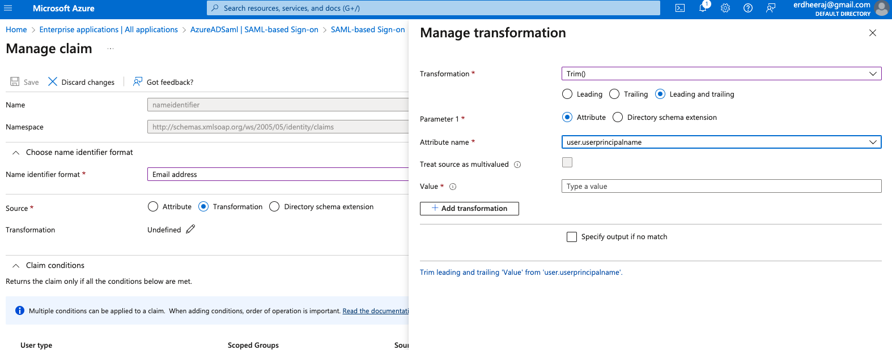

No Luck

15. Lambda Exception Received Specificaloly for microsoft username. This expception primarily is because of the names setup in micsoft AD as below

                microsoftuser01@<your-tenant>.onmicrosoft.com

These names are not accepted by Lambda function. HOWEVER, if I send an event from SAM, i can set email 

                <timestamp>	<REDACTED_REQUEST_ID>	ERROR	Invoke Error 	
                {
                "errorType": "InvalidParameterException",
                "errorMessage": "2 validation errors detected: Value at 'username' failed to satisfy constraint: Member must satisfy regular expression pattern: [\\p{L}\\p{M}\\p{S}\\p{N}\\p{P}]+; Value at 'username' failed to satisfy constraint: Member must have length greater than or equal to 1",
                "code": "InvalidParameterException",
                "message": "2 validation errors detected: Value at 'username' failed to satisfy constraint: Member must satisfy regular expression pattern: [\\p{L}\\p{M}\\p{S}\\p{N}\\p{P}]+; Value at 'username' failed to satisfy constraint: Member must have length greater than or equal to 1",
                "[__type]": "See error.__type for details.",
                "time": "<timestamp>",
                "requestId": "<REDACTED_REQUEST_ID>",
                "statusCode": 400,
                "retryable": false,
                "retryDelay": 20.905941432856288,
                "stack": [
                        "InvalidParameterException: 2 validation errors detected: Value at 'username' failed to satisfy constraint: Member must satisfy regular expression pattern: [\\p{L}\\p{M}\\p{S}\\p{N}\\p{P}]+; Value at 'username' failed to satisfy constraint: Member must have length greater than or equal to 1",
                        "    at constructor.p8 (/var/task/app.js:1:4830)",
                        "    at constructor.callListeners (/var/task/app.js:1:47941)",
                        "    at constructor.emit (/var/task/app.js:1:47649)",
                        "    at constructor.emitEvent (/var/task/app.js:2:28410)",
                        "    at constructor.t (/var/task/app.js:2:23969)",
                        "    at hc.runTo (/var/task/app.js:2:1213)",
                        "    at /var/task/app.js:2:1425",
                        "    at constructor.<anonymous> (/var/task/app.js:2:24183)",
                        "    at constructor.<anonymous> (/var/task/app.js:2:28465)",
                        "    at constructor.callListeners (/var/task/app.js:1:48046)"
                ]
                }

Issue: To many attempts issue received in iOS. User blocked. Not sure why.

Issue: To many attempts issue received in iOS. User blocked. Not sure why.

In Web, received below after adding details

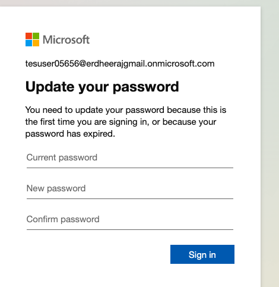

Then I got this error in ios

Above error is resolved by adding users to group as below. 

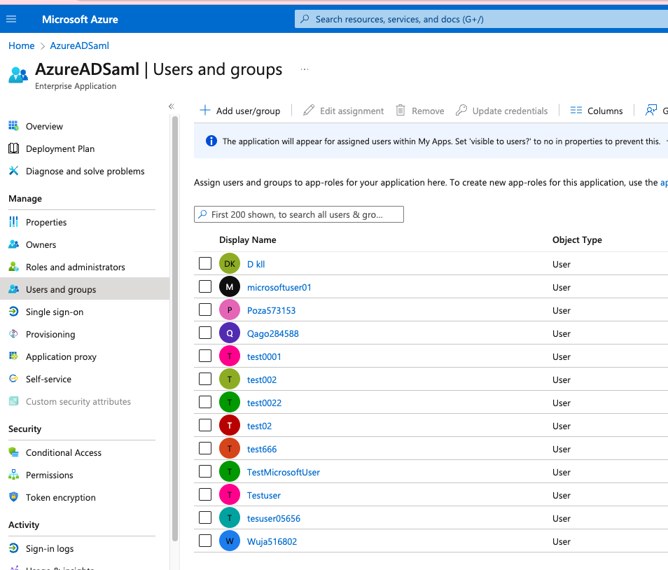

Successded login finally, but failed because of below

        AwsAmplifyLoginRepo: Unhandled AuthException: LambdaException {
        flutter:   "message": "2 validation errors detected: Value at 'username' failed to satisfy constraint: Member must satisfy regular expression pattern: [\\p{L}\\p{M}\\p{S}\\p{N}\\p{P}] ; Value at 'username' failed to satisfy constraint: Member must have length greater than or equal to 1"
        flutter: }

To test, every time you create a user, you need to add to grouby by going below, else same error will occut of 'assigned'. Click add user/group --> click none selected --> find new user, -- and then  add, the select role and add to Users. 

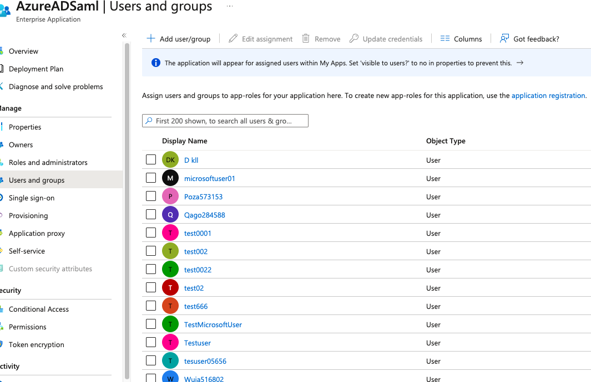

--------------------------------------------------------------------------------------------
